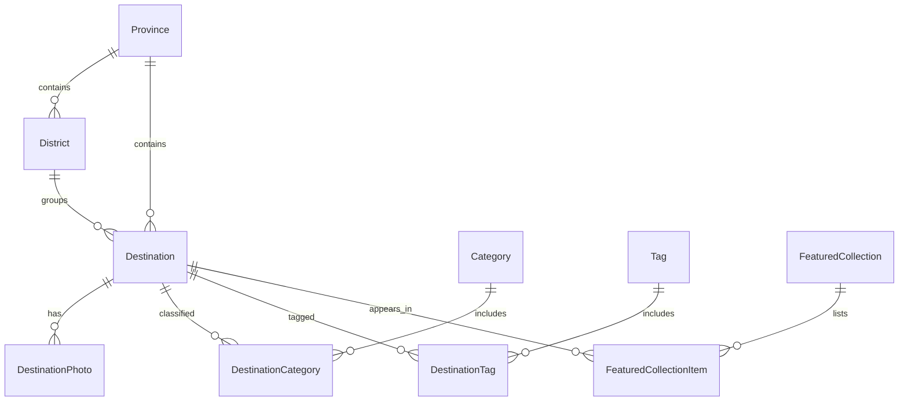

# Geography and destination data model

The initial content domain is modeled in `prisma/schema.prisma` and applied by
`prisma/migrations/20261117010000_geography_domain`.

## Entity relationship



## Models

| Model | Purpose |
| --- | --- |
| `Province` | Top-level Cambodian geography and editorial province pages. |
| `District` | Optional sub-province grouping; destinations may omit it. |
| `Destination` | A place travelers can save, map, and reference from a template. |
| `DestinationPhoto` | Ordered photos with alt text and a recorded credit. |
| `Category` | Editorial classification such as temple, nature, food, island. |
| `Tag` | Lightweight interest labels such as sunrise or slow travel. |
| `DestinationCategory` | Explicit destination-to-category join table. |
| `DestinationTag` | Explicit destination-to-tag join table. |
| `FeaturedCollection` | Editorial grouping for the home and explore surfaces. |
| `FeaturedCollectionItem` | Ordered destinations inside a collection. |

## Invariants

- `slug` is unique on provinces, districts, destinations, categories, tags, and
  featured collections.
- A destination belongs to exactly one province and optionally one district.
- A destination can have many categories and tags.
- Only `PUBLISHED` destinations, provinces, and collections appear in public
  queries.
- Referenced content is archived rather than hard-deleted.
- Photos are ordered per destination; `(destination_id, sort_order)` is unique.
- Every photo has non-empty alt text and a credit or rights note.
- `created_at` and `updated_at` are stored in UTC.

## Geospatial behavior

- `latitude` and `longitude` are the editable source values.
- A PostGIS `geography(Point, 4326)` column named `location` is kept in sync by
  the `destinations_location_sync` trigger.
- A GiST index (`destinations_location_idx`) supports radius and distance
  queries.
- Prisma exposes `location` as an `Unsupported` field; use raw SQL for spatial
  reads and writes.
- Run `scripts/check-geography.mjs` after seeding to verify locations and the
  nearby query.

Example nearby query:

```sql
SELECT name, slug,
       ROUND(ST_Distance(
         location,
         ST_SetSRID(ST_MakePoint(104.181, 10.61), 4326)::geography
       ))::int AS distance_m
FROM destinations
WHERE status = 'PUBLISHED'
  AND location IS NOT NULL
  AND ST_DWithin(
    location,
    ST_SetSRID(ST_MakePoint(104.181, 10.61), 4326)::geography,
    50000
  )
ORDER BY distance_m ASC;
```

## Seed and verification

```bash
npm run db:migrate   # apply pending migrations
npm run db:seed      # idempotent starter data
npm run db:check     # counts, PostGIS locations, nearby query, photo alt text
```

The seed covers seven provinces and ten destinations across temples, coast,
nature, food, and culture. The placeholder landscape is local and carries an
explicit editorial credit; real licensed photography replaces it before launch.

## Next steps

- Admin CRUD for this domain (#16).
- Public explore and destination pages (#18, #19).
- Connect the public home to the featured collections (#17).
- Replace the placeholder seed assets with reviewed, licensed photography (#22).
