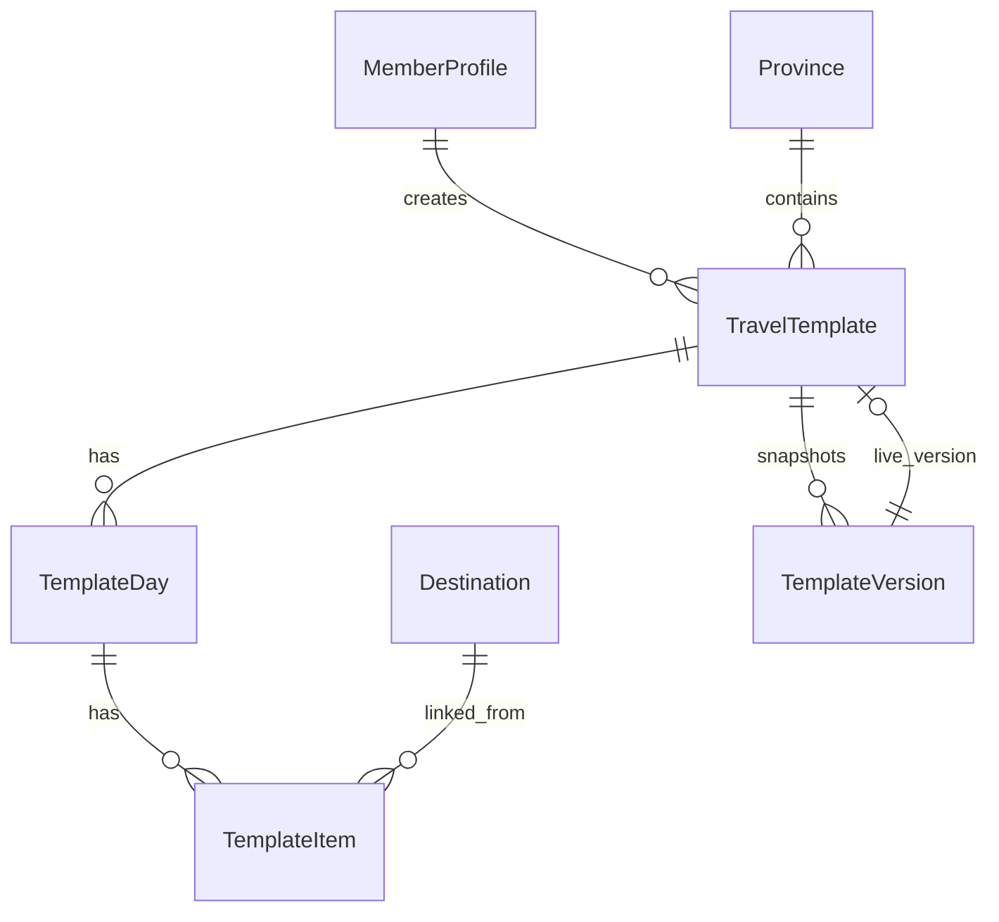

# Travel template and versioning model

The template domain is modeled in `prisma/schema.prisma` and applied by
`prisma/migrations/20261117100000_travel_templates`.

## Entity relationship



## Models

| Model | Purpose |
| --- | --- |
| `MemberProfile` | Public creator identity keyed by the external auth user id. |
| `TravelTemplate` | Editable draft metadata and the pointer to the live version. |
| `TemplateDay` | Ordered day inside the editable draft. |
| `TemplateItem` | Ordered activity, optionally linked to a published destination. |
| `TemplateVersion` | Immutable JSON snapshot created by publishing. |

## Versioning decision

Publishing uses a **JSON snapshot** rather than duplicate normalized tables.

- Draft edits stay in `template_days` and `template_items` and are cheap to
  reorder.
- Publishing builds one JSON document containing metadata, days, items, and
  validation results, then inserts it into `template_versions` in the same
  transaction that updates `travel_templates.published_version_id`.
- A DB trigger rejects every `UPDATE` on `template_versions`. The snapshot is
  immutable; corrections create a new version.
- Copied trips reference `template_id` and `published_version_id` so later edits
  cannot mutate an existing copy.
- The public page reads the live version snapshot, not the editable draft. That
  keeps a published template online while its creator prepares a revision.

A normalized snapshot would make cross-version SQL easier, but it duplicates the
day/item schema, complicates reordering, and is not needed for launch queries.
The JSON document is validated server-side before insertion and is always read
alongside the template row.

## Lifecycle

```text
DRAFT -> PENDING_REVIEW -> PUBLISHED -> UNLISTED / ARCHIVED
                    \-> REJECTED -> PENDING_REVIEW
```

- `DRAFT`: editable, never public.
- `PENDING_REVIEW`: editable only by replacing the submission; not public.
- `PUBLISHED`: has a `published_version_id` and is eligible for public queries.
- `REJECTED`: carries `rejection_reason`; creator can revise and resubmit.
- `UNLISTED`: hidden from listings and public detail pages, attribution kept.
- `ARCHIVED`: hidden permanently from public queries, version kept for trips.

Only rows with `status = 'PUBLISHED'` and a non-null `published_version_id` are
eligible for public queries. Database constraints enforce slug format, positive
duration, budget ordering, day numbering, item ordering, time format, and
non-negative costs.

## Ordering invariants

- `(template_id, day_number)` is unique.
- `(day_id, sort_order)` is unique.
- Day and item order is explicit; it is not inferred from clock times.
- `end_time` must be greater than or equal to `start_time` when both exist.
- Reordering uses a transaction that temporarily offsets sort orders before
  writing final positions.

## Verification

```bash
npm run db:template-check
```

The check creates an isolated fixture, verifies unique slugs and usernames,
unique day and item ordering, time validation, immutable versions, and the
published-only query, then removes the fixture.
