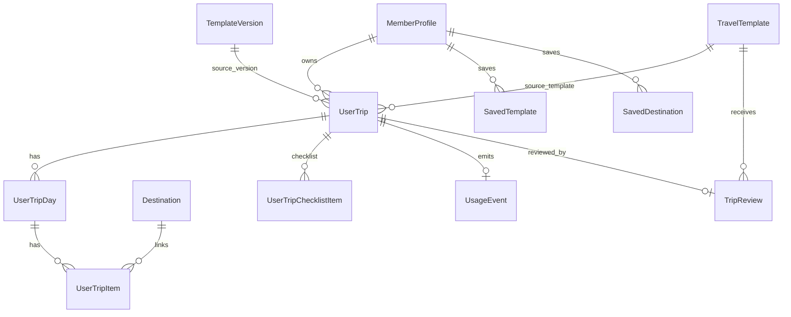

# Traveler workflow

## Entity relationship



## Trip copy

`POST /api/trips/copy` is the transactional Use Template endpoint.

- Requires a signed-in member and a published template version.
- Creates the private trip, copied days and items, and a `PENDING` usage event
  in one transaction.
- Stores `source_template_id`, `source_template_version_id`, the source title,
  and the version number on the trip.
- Requires an idempotency key. A repeated key returns the original trip and
  creates no second usage event.
- The database has a unique `(owner_id, copy_key)` constraint as the final
  concurrency guard.
- A failed copy rolls back the trip, days, items, and usage event together.
- The source attribution columns and owner are immutable through a trigger.
- A linked destination that is no longer published becomes a custom activity
  after copying.

The confirmation page is `/trips/new?template=<id>&version=<id>`. Signed-out
visitors go through `/sign-in` and return to the confirmation.

## My Trips

`/trips` lists only the signed-in member's trips.

Filters: all, upcoming, current, past, drafts, archived. Display status is derived
from dates plus explicit completion or archive.

Actions: open, duplicate, mark complete, archive, delete. Deleting asks for
confirmation and removes source attribution with the trip. Archiving keeps both.

## Trip editor

`/trips/[id]` is a private working surface:

- editable title, dates, and personal notes
- ordered days and items with times, types, destination links, costs, notes, and
  practical tips
- add, edit, duplicate, remove, and move up/down
- personal preparation checklist with toggles
- map of linked destinations
- source template and version shown read-only
- autosave with `Unsaved changes` / `Saving…` / `Saved` / error states
- soft navigation so actions do not full-page reload
- date/day-count and schedule-conflict warnings

## Saved items

`/saved` is private to the signed-in member.

- `PUT /api/saves/templates/[id]` and `DELETE` are idempotent.
- The same applies to destinations.
- `(user_id, template_id)` and `(user_id, destination_id)` are unique.
- Save counts are incremented or decremented only when a row is actually
  created or removed.
- The public save button updates optimistically and rolls back on failure.
- Saved lists show templates and destinations with separate pagination.

## Reviews

Reviews are connected to one completed copied trip and one exact template
version.

- Only the trip owner can review.
- The trip must be completed or past its end date.
- A creator cannot review their own template.
- One review per trip is enforced by a unique constraint.
- Ratings are 1–5; body is optional up to 4000 characters.
- Editing is allowed for 7 days, then locked. Deletion is always available.
- Reviews can be reported. Reported and hidden reviews are excluded from the
  public aggregate.
- Content admins can hide reviews from `/admin/reviews`.
- Reviews never add competition points directly.
- The public template page shows the average rating, visible review count, recent
  reviews, and `AggregateRating` structured data.

## Verification

```bash
npm run db:trip-check
AUTH_E2E=true npm run test:auth
```

The authenticated suite covers idempotent and concurrent copies, rollback,
source immutability, ownership isolation, editing, duplicate/archive/delete,
autosave, checklist behaviour, saves, optimistic rollback, review eligibility,
duplicate reviews, aggregates, reporting, and hiding.
